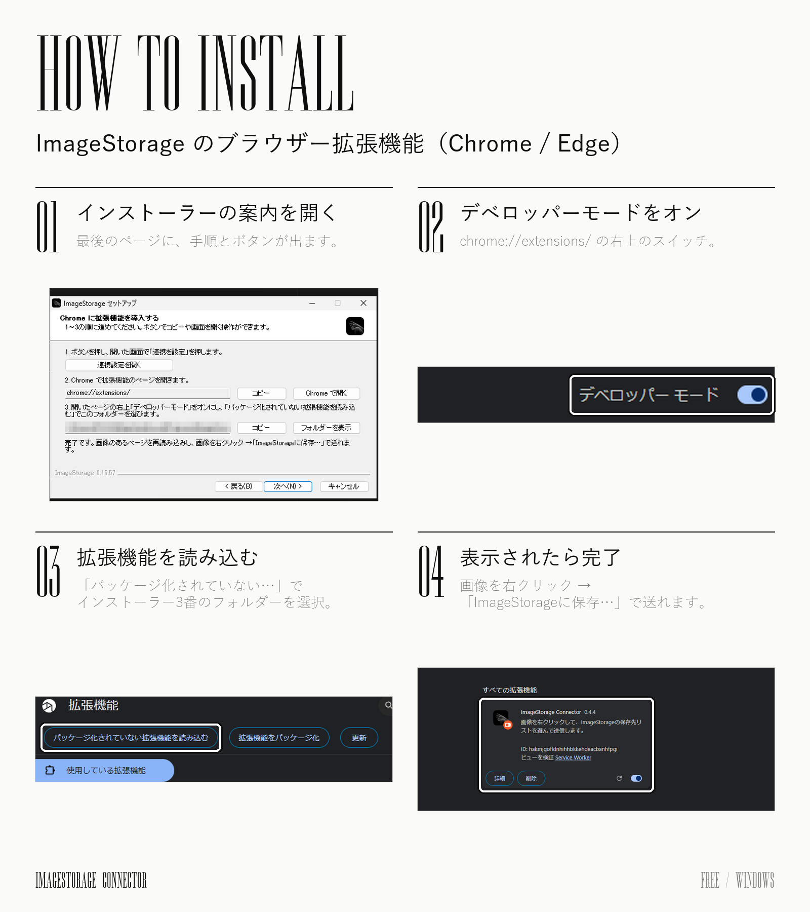

# ImageStorage

[日本語](#日本語) | [English](#english)

---

## 日本語

ImageStorage は、資料画像を集めて、整理して、並べて見るための Windows アプリです。

### ダウンロード

**BOOTH：** https://pooh9135.booth.pm/items/9142066 （無料版・支援版。中身は同じです）

**紹介動画（YouTube）：** https://youtu.be/q_9BoeI2Aso

GitHub の [Releases](https://github.com/pooh9135/ImageStorage/releases/latest) からも、次のファイルをダウンロードできます。

| ファイル | 内容 |
| --- | --- |
| `ImageStorage-0.15.57-Setup.exe` | インストーラー |
| `ImageStorage-Tutorial-JA.mp4` | 使い方の動画（日本語・約7分30秒） |
| `ImageStorage-Tutorial-EN.mp4` | 使い方の動画（英語） |

### インストール

1. `ImageStorage-0.15.57-Setup.exe` をダブルクリックします。
2. 画面の案内に従ってインストールします。

インストーラーにはデジタル署名がないため、「WindowsによってPCが保護されました」と表示される場合があります。その場合は「詳細情報」→「実行」を押してください。

### ブラウザー拡張機能の導入

インストールの最後に、拡張機能の導入手順が画面で案内されます。流れは次のとおりです。



### できること

- 画像をドラッグ＆ドロップで追加して、リストで整理する
- キャンバスに自由に並べる
- 画像を拡大して細部を調べる
- ブラウザーから画像を直接保存する（インストールの最後に拡張機能の導入手順を案内します。インストール先の `browser-connector` フォルダーを使います）
- Pinterest のボードを取り込む
- データをプロジェクトファイルとして保存する

詳しい使い方は、同梱の動画で説明しています。

| 章 | 内容 | 開始 |
| --- | --- | --- |
| 1 | 画面の見方 | 0:00 |
| 2 | 画像を追加する | 0:41 |
| 3 | リストで整理する | 1:18 |
| 4 | キャンバスで並べる | 2:23 |
| 5 | 画像を調べる | 3:20 |
| 6 | ブラウザーから保存する | 4:16 |
| 7 | Pinterestボードを取り込む | 5:39 |
| 8 | データを守る | 6:30 |

アプリの表示言語は、Windows の言語に合わせて始まります。変更するときは「設定」の「表示言語」で選んでください。

### 動作環境

Windows 10 / 11（64ビット）

### チェックサム（SHA-256）

```
0e733cfbc3c6a1166ae7400d19a0dd216184a202b7014c89a50988c792705544  ImageStorage-0.15.57-Setup.exe
```

### ソースからビルドする

Node.js 22.13 以降が必要です。

```bash
npm install
npm run desktop:dev            # 開発用に起動
npm run desktop:build:unsigned # インストーラーを作成（署名なし）
npm test                       # テスト
```

### ライセンス

ソースコードは参照用に公開しています。著作権は作者が保持しており、無断での再配布・改変版の配布はできません。

動画の音楽：Roie Shpigler「Held in Motion」（Artlist）

---

## English

ImageStorage is a Windows app for collecting reference images, organizing them, and laying them out side by side.

### Download

**BOOTH:** https://pooh9135.booth.pm/items/9142066 (Free and Support editions — both are identical)

**Intro video (YouTube):** https://youtu.be/q_9BoeI2Aso

You can also get these files from GitHub [Releases](https://github.com/pooh9135/ImageStorage/releases/latest).

| File | What it is |
| --- | --- |
| `ImageStorage-0.15.57-Setup.exe` | Installer |
| `ImageStorage-Tutorial-EN.mp4` | How-to video (English, about 7.5 minutes) |
| `ImageStorage-Tutorial-JA.mp4` | How-to video (Japanese) |

### Install

1. Double-click `ImageStorage-0.15.57-Setup.exe`.
2. Follow the steps on screen.

The installer is not digitally signed, so Windows may show "Windows protected your PC". Click "More info", then "Run anyway".

### Browser extension

At the end of setup, the installer walks you through adding the extension. The steps look like this (screens in Japanese):


### Features

- Add images by drag and drop and organize them in lists
- Arrange them freely on a canvas
- Zoom in to study an image in detail
- Save images straight from your browser (the installer walks you through adding the extension at the end of setup; uses the `browser-connector` folder in the install folder; its screens are in Japanese for now)
- Import a Pinterest board
- Save your data as a project file

The included video walks through each feature.

| Chapter | Topic | Starts at |
| --- | --- | --- |
| 1 | The screen | 0:00 |
| 2 | Adding images | 0:41 |
| 3 | Organizing with lists | 1:18 |
| 4 | Arranging on the canvas | 2:25 |
| 5 | Studying an image | 3:24 |
| 6 | Saving from the browser | 4:20 |
| 7 | Importing a Pinterest board | 5:43 |
| 8 | Keeping your data safe | 6:34 |

The app starts in your Windows language. To change it, open Settings and choose "Display language".

### Requirements

Windows 10 / 11 (64-bit)

### Checksum (SHA-256)

```
0e733cfbc3c6a1166ae7400d19a0dd216184a202b7014c89a50988c792705544  ImageStorage-0.15.57-Setup.exe
```

### Build from source

Requires Node.js 22.13 or later.

```bash
npm install
npm run desktop:dev            # run in development
npm run desktop:build:unsigned # build the installer (unsigned)
npm test                       # run the tests
```

### License

The source code is published for reference. All rights reserved: please do not redistribute it or distribute modified versions without permission.

Music in the videos: "Held in Motion" by Roie Shpigler (Artlist)
